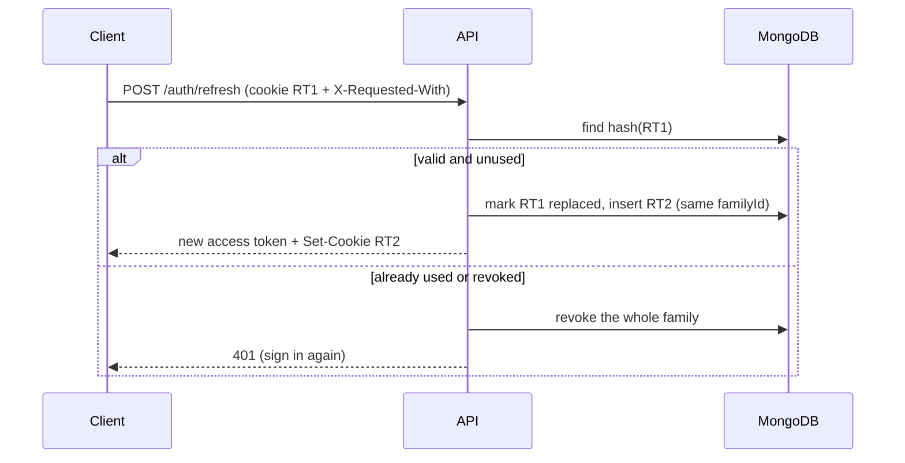

# Authentication and Security

## Credentials
- Passwords: argon2id (memory 19 MiB, time 2, parallelism 1). Length 10 to 128 characters.
- `passwordHash` is never logged or returned (`select: false`).
- Login errors are generic ("Invalid credentials"). A dummy hash is verified for unknown emails, so timing does not
  reveal which emails exist. Login is rate limited per IP and per account (`AUTH_RATE_LIMIT_MAX`, `LOGIN_FAILURE_LIMIT_MAX`).
- Password reset: opaque token, only its SHA-256 hash is stored, single use, expiring. The response is identical
  whether or not the email exists.

## Registration
Registration is first-run only. `POST /auth/register` creates the first user and the organization, then returns 403
`REGISTRATION_CLOSED` for everyone else. Further users join by invitation.

## Tokens
| Token | Format | Lifetime | Storage |
|---|---|---|---|
| Access | JWT, claims include the user id and `tokenVersion` | `JWT_ACCESS_EXPIRES_IN` (default 15m) | Client memory only |
| Refresh | Opaque random string | `JWT_REFRESH_EXPIRES_IN` (default 7d); session cookie when "remember me" is off | httpOnly cookie `ef_rt`, `Secure` in production, `SameSite=Strict`, `Path=/api/v1/auth` |

The server stores only the **SHA-256 hash** of each refresh token (`refreshtokens`).

### Rotation and reuse detection

- **Logout** revokes the current family and clears the cookie.
- **Logout all** bumps `tokenVersion` and revokes every family.
- Access tokens are rejected when their `tokenVersion` no longer matches the user's.
- Suspended users are rejected at `authenticate`.

### CSRF
The refresh cookie is `SameSite=Strict` and scoped to `/api/v1/auth`. `/auth/refresh` and `/auth/logout` also require
the header `X-Requested-With: EstateFlow` (which forces a CORS preflight that foreign origins cannot pass) and, when
the browser sends an `Origin`, it must be on the `FRONTEND_URL` allowlist. Every other endpoint uses the Bearer header,
so it is not CSRF-prone.

## Authorization
Two layers:
1. **Role defaults** (OWNER, ADMIN, MANAGER, AGENT): a static map from role to permissions in `members/permissions.ts`.
2. **Per-member overrides**: `permissions` (grants) and `deniedPermissions` (revokes).

Effective permissions = (role defaults ∪ grants) − denied. Middleware: `authorize('leads:update')`. Ownership rules
(for example, agents see only records assigned to them unless they have `*:read_all`) are enforced in services.

| Permission area | OWNER | ADMIN | MANAGER | AGENT |
|---|---|---|---|---|
| License (`license:read`, `license:manage`) | Yes | **No** | No | No |
| Delete organization (`org:delete`) | Yes | No | No | No |
| Organization settings (`org:update`) | Yes | Yes | No | No |
| Members (`members:*`) | Yes | Yes | Read | No |
| Leads, contacts, properties, deals, tasks: read all | Yes | Yes | Yes | Own/assigned |
| Delete records | Yes | Yes | No | No |
| Analytics | Yes | Yes | Yes + team | Own numbers only |
| Reports and export | Yes | Yes | Yes | Read only |
| Automations | All | All | Read | No |

A licensed feature is a second, independent gate: a user may have `analytics:read` and still receive 403
`FEATURE_NOT_LICENSED` if the license does not include analytics.

## Licensing security
- License keys are Ed25519-signed by the vendor. Installs hold only the public key. A customer can verify a key but
  cannot create one.
- The key itself is never stored or logged: only `sha256(key)` and the last 4 characters. API responses never include either the key or its hash.
- Verification errors are deliberately generic.
- Entitlements are resolved on the server from persisted data only. No request value is ever consulted.
- Only the OWNER can activate or deactivate. Both write an audit entry.

## Audit logging
Written by the `audit` service, not controllers: registration, login failures, password reset, refresh-token reuse, logout-all,
license activation and deactivation, organization updates, report exports, and create, update, assign, archive and
restore of deals, properties, contacts and tasks. Entries
include actor, organization, action, resource, sanitized before/after, IP, user agent and request id. Append-only:
the application has no update or delete path.

## Platform hardening
- `helmet`, strict credentialed CORS allowlist (`FRONTEND_URL`, never a wildcard), HTTPS only in production, `TRUST_PROXY` set explicitly.
- Global rate limit, stricter limits on `/auth/*`, a write limiter on mutating routes.
- Body size limits; Zod-typed inputs; unknown fields rejected or stripped; objects with `$` keys rejected.
- Uploads: type and size allowlist, random storage keys.
- Secrets only through the environment. Startup fails if a required secret is missing or weak (JWT secrets at least 32 characters and different from each other).
- Structured logs with request ids; secrets redacted.

## Environment variables
| Variable | Purpose | Default |
|---|---|---|
| `NODE_ENV` | `development`, `test`, `production` | development |
| `PORT` | API port | 4000 |
| `MONGODB_URI` | MongoDB connection string (replica set required for transactions) | required |
| `JWT_ACCESS_SECRET`, `JWT_REFRESH_SECRET` | Token signing secrets, 32+ characters, different | required |
| `JWT_ACCESS_EXPIRES_IN`, `JWT_REFRESH_EXPIRES_IN` | Token lifetimes | 15m, 7d |
| `FRONTEND_URL` | Allowed browser origin(s), comma separated | `http://localhost:5173` |
| `COOKIE_DOMAIN` | Cookie domain, empty in development | empty |
| `LOG_LEVEL`, `TRUST_PROXY` | Logging and reverse-proxy trust | info, 0 |
| `AUTH_RATE_LIMIT_MAX`, `LOGIN_FAILURE_LIMIT_MAX` | Auth throttles | 20, 5 |
| `REMINDER_*` | Task reminder scheduler (enabled, poll interval, batch size, lock lease) | enabled |
| `AUTOMATION_*` | Automation engine (enabled, batch size, max depth) | enabled |
| `EMAIL_PROVIDER` | `disabled`, `log`, `memory` | disabled |
| `LICENSE_PUBLIC_KEY` | Vendor Ed25519 public key (PEM) | none |
| `LICENSE_GRACE_DAYS` | Grace days after a license ends | 14 |