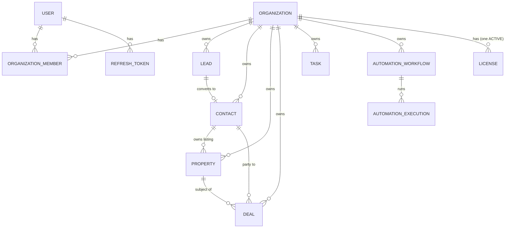

# Database Schema (MongoDB / Mongoose)

## Global conventions
- `timestamps: true` on schemas (append-only collections keep only `createdAt`).
- `_id` is an ObjectId; references use `ref`. Mongoose pluralizes model names (`Lead` is the `leads` collection).
- Org-owned collections have a required `organizationId`, the first field of their compound indexes.
- Emails are lowercased and trimmed. Enum values live in `apps/api/src/constants.ts`.
- Business records use **soft delete** (`deletedAt`, `deletedBy`).
- Money is stored as **integer minor units** with a currency code, and is never summed across currencies.
- No plaintext passwords, tokens or license keys are stored: only hashes.
- Search uses a `searchKeywords` array (`select: false`) and sort helpers such as `nameSort`, `statusRank`, `priorityRank`.
  They are derived fields kept by the services.

## Collections
| Group | Models |
|---|---|
| Identity and tenancy | `User`, `Organization`, `OrganizationMember`, `Invitation`, `RefreshToken`, `PasswordResetToken` |
| CRM | `Lead`, `Contact`, `Property`, `Deal`, `Task`, `Activity` |
| Notifications | `Notification`, `NotificationPreference` |
| Automation | `AutomationWorkflow`, `AutomationEvent`, `AutomationExecution`, `EmailDelivery` |
| Audit | `AuditLog` |
| Licensing | `License`, `UsageLock` |

## Identity and tenancy

### User
name (2-100), email (unique, lowercase), passwordHash (`select: false`), avatar, phone, status (ACTIVE, SUSPENDED, DELETED),
emailVerified, platformRole (`NONE`, `PLATFORM_ADMIN`; legacy, unused by the self-hosted edition), tokenVersion, lastLoginAt, deletedAt.
Index: `{email:1}` unique.

### Organization
name, slug (unique), logo, email, phone, address `{line1, city, state, country, postalCode}`, ownerId, timezone (IANA, default UTC),
currency (ISO 4217, default USD), status (ACTIVE, SUSPENDED, DELETED), deletedAt.
Indexes: `{slug:1}` unique, `{ownerId:1}`.

### OrganizationMember
organizationId, userId, role (OWNER, ADMIN, MANAGER, AGENT), permissions (extra grants), deniedPermissions,
invitationStatus (PENDING, ACCEPTED, DECLINED, REVOKED; default ACCEPTED), status (ACTIVE, SUSPENDED), joinedAt.
Indexes: `{organizationId:1, userId:1}` unique, `{userId:1}`, `{organizationId:1, role:1}`, and a partial unique index
that allows one OWNER per organization.

### Invitation
organizationId, email, role (not OWNER), invitedBy, tokenHash (unique), status (PENDING, ACCEPTED, REVOKED, EXPIRED),
expiresAt, acceptedAt, revokedAt. Indexes: `{tokenHash:1}` unique, `{organizationId:1, email:1}`, TTL on `expiresAt`
(purged 30 days after expiry). Pending, unexpired invitations count toward the license `members` limit.

### RefreshToken
userId, familyId, tokenHash (unique), expiresAt, revokedAt, replacedByTokenId, persistent, userAgent, ip.
Indexes: `{tokenHash:1}` unique, `{userId:1, familyId:1}`, TTL on `expiresAt`.

### PasswordResetToken
userId, tokenHash (unique), expiresAt, usedAt, createdAt. Indexes: `{tokenHash:1}` unique, `{userId:1, usedAt:1}`, TTL on `expiresAt`.

## CRM

### Lead
organizationId, assignedTo, firstName, lastName, email, phone, alternate phone,
leadSource (WEBSITE, FACEBOOK, INSTAGRAM, WHATSAPP, REFERRAL, WALK_IN, PROPERTY_PORTAL, PHONE_CALL, OTHER),
leadType (BUYER, SELLER, TENANT, LANDLORD, INVESTOR),
status (NEW, CONTACTED, QUALIFIED, MEETING_SCHEDULED, NEGOTIATION, WON, LOST), priority (LOW, MEDIUM, HIGH, URGENT),
budget `{min, max, currency}` (minor units), preferredLocation (max 20), interestedPropertyType, notes (5000),
nextFollowUpAt, convertedContactId, convertedAt, wonAt, lostAt, lostReason, createdBy, deletedAt, deletedBy,
plus derived fields (statusRank, priorityRank, nameSort, hasFollowUp, searchKeywords).
Indexes are all prefixed with `organizationId`: by `deletedAt` and `createdAt`, status, assignee and status, follow-up,
priority and status rank, `nameSort`, `searchKeywords`, phone, email (sparse), `convertedContactId` (sparse).

### Contact
organizationId, linkedLeadId, assignedTo, firstName, lastName, email, phone, contactType (BUYER, SELLER, TENANT, LANDLORD,
INVESTOR, OTHER), status (ACTIVE, INACTIVE), tags (max 20), preferredContactMethod (PHONE, EMAIL, WHATSAPP, SMS), source,
createdBy, deletedAt, deletedBy, nameSort, searchKeywords. Indexes prefixed with `organizationId` for type, status,
assignee, tags, phone, `nameSort`, `searchKeywords`, plus partial unique indexes: one active contact per email per
organization (`unique_active_email_per_org`) and one contact per lead (`one_contact_per_lead`).

### Property
organizationId, title, propertyType (HOUSE, APARTMENT, PLOT, COMMERCIAL, OFFICE, FARMHOUSE, OTHER),
listingType (SALE, RENT, LEASE), propertyStatus (DRAFT, AVAILABLE, UNDER_OFFER, RESERVED, SOLD, RENTED, LEASED, INACTIVE),
bedrooms, bathrooms, area, areaUnit (SQFT, SQM, MARLA, KANAL, ACRE), floors, furnishingStatus, parkingSpaces, yearBuilt,
amenities, latitude, longitude, priceAmount (integer, 1 to 1e13), currency, rentPeriod (DAILY to YEARLY), ownerContactId,
assignedTo, images (max 20: key, url, mimeType, size, uploadedBy, uploadedAt), primaryImage, closedByDealId, createdBy,
deletedAt, deletedBy, searchKeywords. Indexes prefixed with `organizationId` for status, type, listing type, assignee,
city, price, owner contact and `searchKeywords`.

### Deal
organizationId, title, contactId, leadId, propertyId, dealType (SALE, RENT, LEASE), stage (NEW, QUALIFICATION,
PROPERTY_MATCHED, VIEWING_SCHEDULED, NEGOTIATION, CONTRACT, WON, LOST), valueAmount (integer minor units), currency,
probability (0-100), expectedClosingDate, actualClosingDate, assignedTo, stageChangedAt, createdBy, deletedAt, deletedBy,
searchKeywords. Indexes prefixed with `organizationId` for stage, assignee, property, contact, lead, closing dates.
A partial unique index (`one_won_deal_per_property`) allows only one WON, non-deleted deal per property.

### Task
organizationId, title, taskType (CALL, MEETING, PROPERTY_VIEWING, FOLLOW_UP, EMAIL, DOCUMENTATION, GENERAL),
status (TODO, IN_PROGRESS, COMPLETED, CANCELLED), priority, dueAt, reminderAt, completedAt, assignedTo, createdBy,
relatedEntityType (LEAD, CONTACT, PROPERTY, DEAL) and relatedEntityId, tags, automationKey (partial unique, so an
automation never creates the same task twice), reminder bookkeeping (reminderStatus, reminderVersion,
reminderNextAttemptAt, reminderAttempts, lock fields, reminderDeliveredAt), overdueNotifiedAt, sort helpers, deletedAt.

### Activity (append-only)
organizationId, userId, entityType (LEAD, CONTACT, PROPERTY, TASK, DEAL, AUTOMATION), entityId, activityType (CALL, EMAIL,
MEETING, NOTE, STATUS_CHANGE, FOLLOW_UP, PROPERTY_VIEWING, OTHER, CREATED, ASSIGNMENT, UPDATE, CONVERTED),
description (2000), metadata. Indexes: `{organizationId, entityType, entityId, createdAt:-1}`, `{organizationId, userId, createdAt:-1}`.

## Notifications

### Notification
organizationId, recipientUserId, type (task, lead, deal, property and automation types), title, message, relatedEntityType,
relatedEntityId, taskId, isRead, readAt, deliveryKey (partial unique per organization), deletedAt (soft delete keeps the key).
### NotificationPreference
organizationId, userId (unique together), preferences (per type). Mandatory types cannot be disabled.

## Automation
- **AutomationWorkflow:** name, status (DRAFT, ACTIVE, PAUSED, ARCHIVED), version, triggerType (21 triggers), triggerConfig,
  conditions (max 10, flat), conditionOperator (ALL, ANY), actions (max 5), executionSettings, createdBy, updatedBy,
  lastExecutedAt, deletedAt.
- **AutomationEvent:** type, entityType, entityId, workflowId, payload snapshot, idempotencyKey (unique per organization),
  depth, chain, status (PENDING, PROCESSING, PROCESSED, FAILED), attempts, lease fields. TTL: kept 30 days after processing.
- **AutomationExecution:** workflowId, workflowVersion, triggerEventId (unique per workflow and event), status, actions,
  actionResults, attempts, retryCount, depth, lease fields, timings.
- **EmailDelivery:** userId (a reference; the address is not copied), deliveryKey (unique per organization), provider,
  status (QUEUED, SENT, FAILED), attempts, error.

## AuditLog (append-only)
organizationId, actorId, action (for example `deal.won`, `license.deactivated`), resource, resourceId, metadata (sanitized
before/after, IP, user agent, request id), createdAt. Indexes: `{organizationId, createdAt:-1}`,
`{organizationId, resource, resourceId}`, `{actorId, createdAt:-1}`. Never contains secrets.

## Licensing

### License
organizationId, licenseId (the signed `jti`; unique), licenseKeyHash (SHA-256 of the normalized key; unique; `select: false`;
never returned), keyLast4, licensee, edition (STANDARD, PROFESSIONAL, AGENCY), status (INACTIVE, ACTIVE, REVOKED),
features, limits (copied from the signed license), issuedAt, activatedAt, expiresAt (null = perpetual), activatedBy.
An ACTIVE row past `expiresAt` is treated as expired in code, so status alone never grants access.
Indexes: `{licenseKeyHash:1}` unique, `{licenseId:1}` unique, `{organizationId:1, updatedAt:-1}`, and
`one_active_license_per_org`: `{organizationId:1}` unique where `status = ACTIVE`.

### UsageLock
organizationId, key, owner, lockedUntil. A short lease that serializes "check the limit, then create" per organization.
Index: `{organizationId:1, key:1}` unique.

## Relationships

## Validation requirements
- Inputs are validated by Zod at the API edge; Mongoose validators are a second line of defense.
- References (assignedTo, ownerContactId, contactId, propertyId, related ids) must belong to the **same organization**; services verify it.
- Strings have maximum lengths and arrays are capped.

## Tenant isolation
See `MULTI_TENANCY.md`.