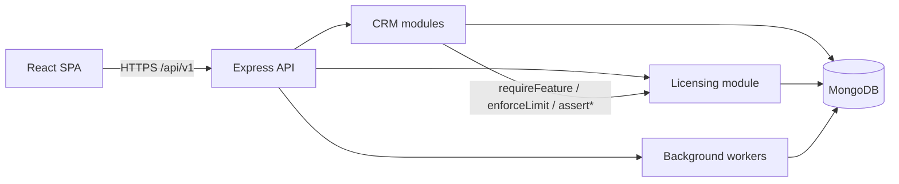
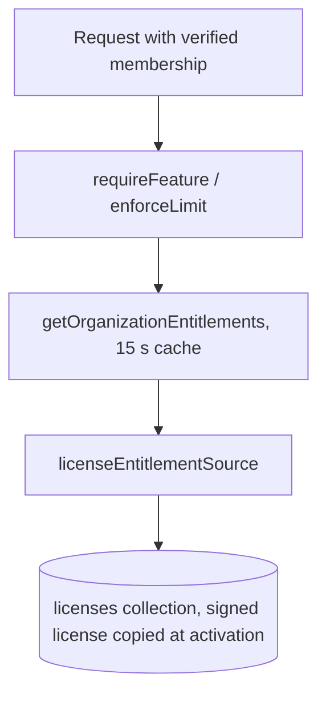
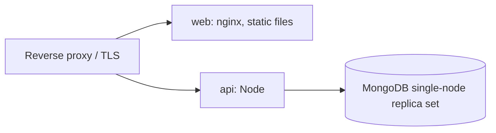

# System Architecture

## 1. Style: modular monolith
One deployable API, one SPA, one MongoDB. Modules are isolated by folder and by dependency rules, so extraction into
services is possible later but not planned.


Background workers run inside the API process: the task reminder scheduler and the automation engine (event queue,
time-trigger scanner, execution runner). Both claim work with database leases, so several API instances are safe.

## 2. Layers and dependency rules
```
routes -> controllers -> services -> models
```
- Controllers handle HTTP only (parse, call the service, shape the response).
- Services hold business logic and are framework free (no `req` or `res`).
- Models hold schema, indexes and validation.
- CRM modules use licensing only through `licensing/entitlements.middleware.ts` (route guards) and
  `licensing/entitlements.service.ts` (`assertWithinLimit`, `assertFeature`, `hasFeature`). They never read license rows or keys.
- Multi-document changes go through `runUnitOfWork` (a transaction, with a standalone fallback).
- `packages/shared` is imported by both apps and contains no Node- or browser-specific code.

## 3. Backend layout
```
apps/api/src/
  config/        env validation (Zod), database, cors
  middleware/    authenticate, resolve-organization, require-membership, authorize, validate,
                 rate-limit, csrf, request-context, error-handler, not-found
  modules/
    auth users organizations members invitations refresh-tokens audit activities
    leads contacts properties deals tasks notifications
    analytics reports automations
    licensing/   license.catalog, license.model, license.crypto, entitlements.service,
                 entitlements.middleware, license.service, license.validation, license.routes
    health
  scripts/       license-tool.ts (vendor CLI: keygen, issue, inspect)
  utils/         app-error, api-response, async-handler, transaction, token, cookies, mailer ...
  routes.ts  app.ts  server.ts  constants.ts
```
Request chain for an organization route:
`requestContext -> helmet, cors, global rate limit -> body parser -> authenticate -> resolveOrganization -> requireMembership -> (requireFeature | authorize | enforceLimit) -> validate -> controller -> service`.

## 4. Frontend layout
```
apps/web/src/
  components/  ui and shared presentational components
  features/    auth, dashboard, leads, contacts, properties, deals, tasks, calendar, notifications,
               analytics, reports, automations, settings
  layouts/ pages/ routes/ providers/ hooks/ services/ (api client) lib/ types/
```
- Server state: TanStack Query. Forms: React Hook Form with Zod.
- The access token lives in memory only; the refresh token is an httpOnly cookie.
- The UI may hide or disable controls based on `GET /licenses/status`, but **the server is the authority**.

## 5. Edition
EstateFlow ships as a single self-hosted edition run by the customer under a license (see `SELF_HOSTED.md`). There is no
deployment-mode switch and no other entitlement source.



## 6. Entitlements
```ts
getOrganizationEntitlements(orgId): Promise<Entitlements>
// { source, edition, state, features, limits, validUntil, graceEndsAt }
```
- Features and limits come from the ACTIVE license row. No license, an expired license beyond the grace period, a deactivated
  or revoked license give `RESTRICTED_ENTITLEMENTS` (no features, every limit 0).
- `registerEntitlementSource` swaps the source (tests register an unlimited one).
- Counting and locking: `countUsage` derives usage from the records themselves; `acquireUsageSlot` serializes check-then-create per organization.

## 7. Deployment topology

Target: `docker compose up` runs `web`, `api` and `mongo` from a `.env` file. Today only `docker/docker-compose.dev.yml` (MongoDB) exists.

## 8. Key decisions
| Decision | Reason |
|---|---|
| Modular monolith | Small team, simple operations, enough scalability |
| Self-hosted only, one build | No billing, no mode switch, less to secure and support |
| Offline signed licenses | No license server to run; installs verify keys with a public key |
| Limits hard on create, never destructive | A lapsed license can never cost a customer their data |
| Single database, `organizationId` scoping | Isolation does not depend on how many organizations exist |
| Access token in memory plus httpOnly refresh cookie | Reduces XSS token theft |
| Money as integer minor units | Exact arithmetic, no float drift |